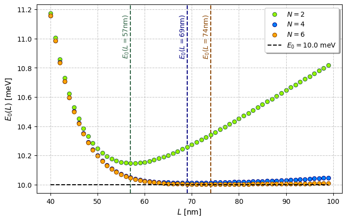
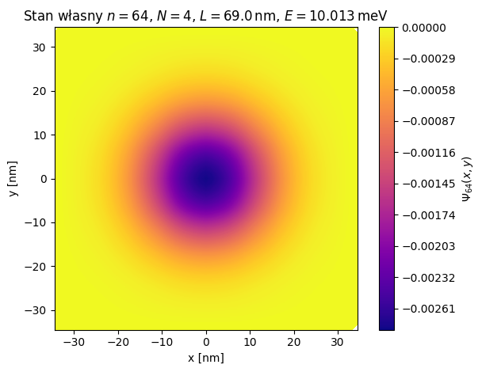
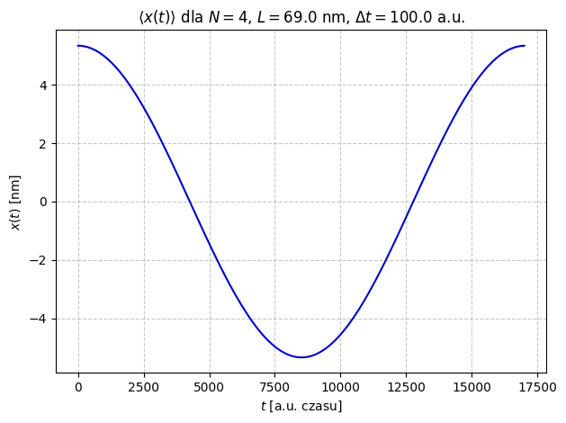

# 2D Quantum Harmonic Oscillator - Finite Element Method

Python implementation of the finite element method (FEM) for a two-dimensional quantum harmonic oscillator. The project calculates energy levels and eigenstates, studies the influence of mesh density and domain size, and simulates wavefunction evolution with the Crank–Nicolson method.

[Open the notebook](MES.ipynb) · [Read the report (PDF, Polish)](docs/MES_Results_and_discussion.pdf) · [Dataset documentation](data/README.md)



## Physical model

The stationary Schrödinger equation is solved in a square domain with zero Dirichlet boundary conditions:

$$
\hat{H} = -\frac{\hbar^2}{2m^*}\left(\frac{\partial^2}{\partial x^2}+\frac{\partial^2}{\partial y^2}\right) + \frac{m^{\ast}\omega^2}{2}(x^2+y^2).
$$

The effective mass is $m^*=0.067m_e$ and $\hbar\omega=10\,\mathrm{meV}$. The infinite-domain theoretical ground-state energy is therefore $E_0=10\,\mathrm{meV}$.

The implementation uses:

- Nine-node biquadratic square elements and tensor-product, four-point Gauss–Legendre quadrature.
- Local overlap, kinetic-energy and potential-energy matrices, assembled into global matrices.
- The generalized eigenvalue problem $Hc=ESc$, solved with `scipy.linalg.eigh`.
- A scan over $N\in\{2,4,6\}$ and $L=40,41,\ldots,99\,\mathrm{nm}$.
- Crank–Nicolson propagation of a normalized superposition of the ground state and first excited state, with wavefunction snapshots and the position expectation value $\langle x(t)\rangle$.

Here, $L$ is the side length of the square. There are $2N$ elements per side, $4N^2$ elements in total, and $(4N+1)^2$ global nodes.

## Reported results

The following values come from the saved notebook outputs. The PDF report gives their interpretation.

| Mesh parameter $N$ | Elements | Global nodes | Best sampled $L$ [nm] | Minimum $E_0$ [meV] |
| --- | ---: | ---: | ---: | ---: |
| 2 | 16 | 81 | 57 | 10.146513 |
| 4 | 64 | 289 | 69 | 10.012602 |
| 6 | 144 | 625 | 74 | 10.003277 |

The notebook selects $N=4$, $L=69\,\mathrm{nm}$ for the subsequent calculations as a compromise between accuracy and computational cost. Its ground-state energy differs from the infinite-domain result by approximately 0.126%.



The time-dependent calculation uses a step of 100 atomic units of time and follows approximately one oscillation period.



These three preview images were extracted from the supplied notebook's saved outputs; they do not represent a new verification run.

## Run locally

The original notebook records Python **3.13.2**. Start in the repository's root directory, containing `MES.ipynb` and `requirements.txt`.

**Windows (PowerShell or Command Prompt):**

```powershell
python -m venv .venv
.venv\Scripts\python.exe -m pip install -r requirements.txt
.venv\Scripts\python.exe -m jupyterlab
```

**Linux / macOS:**

```bash
python3 -m venv .venv
.venv/bin/python -m pip install -r requirements.txt
.venv/bin/python -m jupyterlab
```

Open `MES.ipynb`, then use **Kernel → Restart Kernel and Run All Cells**. Execute the cells in order: later sections depend on matrices and eigenstates computed earlier.

The complete parameter scan solves 180 generalized eigenvalue problems and may take several minutes, depending on the computer. Calculations use dense matrices. Generated PDF plots are saved to `outputs/`, which is excluded from Git.

Exact dependency versions were not supplied with the original notebook. `requirements.txt` lists the required packages but does not define a locked environment.

## Repository contents

| Path | Contents |
| --- | --- |
| `MES.ipynb` | FEM implementation, analysis and saved results. Notebook headings and plot labels are in Polish. |
| `data/mesh/` | Six required mesh files: node coordinates and local-to-global mappings for $N=2,4,6$. |
| `data/reference/` | Four supplied matrix exports, retained for comparison. The notebook does not load these automatically. |
| `data/README.md` | Data formats, indexing conventions and reference-export notes. |
| `docs/MES_Results_and_discussion.pdf` | Original 12-page report in Polish. |
| `docs/images/` | Three preview images extracted from saved notebook outputs. |
| `requirements.txt` | Python dependencies and JupyterLab. |
| `LICENSE` | MIT license for the original project material. |

The published copy adds a short introductory cell, removes unused imports, and directs data loading and plot exports to the folders above. The numerical routines are preserved.

## Numerical notes

- The simulation uses a finite square domain. Small domains introduce confinement error; large domains at fixed $N$ increase element size and discretization error.
- Boundary degrees of freedom are assigned artificial negative eigenvalues and excluded when selecting the positive physical spectrum. The `n` values in plot titles are indices in the full eigensystem, rather than the usual oscillator quantum numbers.
- The included matrix exports use one-based indices. Printed notebook DataFrames use zero-based indices. Small numerical differences also occur between the supplied matrix exports and the saved notebook outputs; the original export environment was not supplied.

## Author and license

**Marcin Drąg** — academic computational physics project, AGH University of Krakow, Faculty of Physics and Applied Computer Science.

Original code, numerical data and project documentation are available under the [MIT License](LICENSE). Institutional logos and any other third-party material in the report retain their respective rights.
